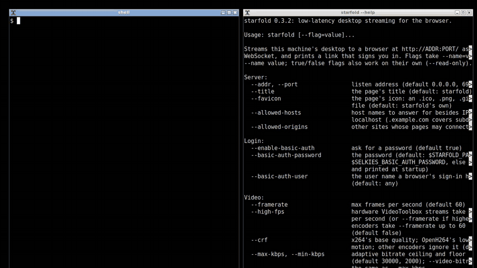

<p align="center">
  <a href="LICENSE"></a>
  <a href="https://github.com/kyora-sh/starfold/actions/workflows/ci.yml"></a>
</p>



kyora starfold streams a desktop to a plain browser tab over one WebSocket: an X11 display (Xvfb
included), a Mac's screen or a Windows desktop. The browser decodes with WebCodecs. H.264 is the
baseline, and the server and the browser negotiate HEVC or AV1 where both have them. It carries the
mouse, keyboard and touch, the clipboard, audio and the microphone, file transfer and dynamic resolution.
Agents get HTTP APIs for screenshots, recordings, input and waiting until the screen settles.

## Quick start

```sh
cargo install --locked --path crates/starfold-server   # needs x264, libyuv, Opus, PulseAudio and esbuild (see Build)
DISPLAY=:1 starfold         # streams display :1 and prints a link that signs you in
```

Open the link it prints. On a Mac or a Windows PC, `starfold` streams that machine's own screen
instead; see [macOS](#macos) and [Windows](#windows).

## Benchmarks

[`bench/results/2026-11-starfold-vs-novnc.md`](bench/results/2026-11-starfold-vs-novnc.md) measures
starfold against noVNC as kyora runs it, on kyora VMs at 1920x1080 with a 30 fps source, on the LAN
and on 20 and 2 Mbit/s links with 50 ms RTT: frame rate, key-to-paint latency, picture quality against
the X server's own pixels, and bandwidth. The sets of its
[8 November refresh](bench/results/2026-11-starfold-vs-novnc.md#refresh-8-november-2026-13-against-main)
interleave the arms on one VM and carry an A/A arm, so a difference there only counts beyond what the
same binary shows against itself; the file's earlier sets and macOS jobs don't all have those
controls, and each says which it has. The harness is in [`bench/vs/`](bench/vs) and the method,
caveats and raw cells are in the results file.

## Build

Rust, a C++ compiler, clang, pkg-config, x264, libyuv, libopus, libpulse and esbuild;
`nix-shell --arg withRust true` provides them all (plain `nix-shell` all but Rust, for your own
toolchain). The H.264 encoder is x264. OpenH264, built from source (needs nasm), is optional:
`--features openh264` adds it beside x264 (`--encoder openh264`), and
`--no-default-features --features openh264` builds without x264 (see [Licensing](#licensing)).

```sh
nix-shell --arg withRust true
cargo build --release
```

Or install it with the same libraries on your system (the crate is `starfold-server`, the binary is
`starfold`):

```sh
cargo install --locked --path crates/starfold-server
```

## Usage

Run it against an X display, then open the link it prints (`?stats` adds an FPS overlay,
`?present=canvas` paints into a canvas instead of `<video>`; a page embedding it can wait for the
`starfold:firstframe` event on `window` rather than `load`):

```sh
DISPLAY=:1 ./target/release/starfold --port=6901
# prints: open http://localhost:6901/?token=4f1c… to sign in
```

Start Xvfb with `-shmem` for zero-copy capture, and use the patched Xvfb
(`nix-build -E 'with import <nixpkgs> {}; callPackage ./xvfb.nix {}'`) for pixel-precise scroll
input; stock Xvfb scrolls by wheel notches. `starfold --help` lists every flag with its default, and
`starfold --version` prints the version.

| Flag                                                           | Default                                                               |                                                                                                                                                                                                           |
| -------------------------------------------------------------- | --------------------------------------------------------------------- | --------------------------------------------------------------------------------------------------------------------------------------------------------------------------------------------------------- |
| `--addr`, `--port`                                             | `0.0.0.0`, `6901`                                                     | listen address                                                                                                                                                                                            |
| `--display`                                                    | `$DISPLAY`                                                            | X display to stream when `DISPLAY` is unset                                                                                                                                                               |
| `--title`                                                      | `starfold`                                                            | the page's title: the browser tab, and the app's name if a viewer installs it                                                                                                                             |
| `--favicon`                                                    | starfold's icon                                                       | the tab's icon: an `.ico`, `.png`, `.gif`, `.webp` or `.svg` file                                                                                                                                         |
| `--enable-basic-auth`                                          | `true`                                                                | ask for a password (see [Login](#login)); `false` serves without one                                                                                                                                      |
| `--basic-auth-password`                                        | `STARFOLD_PASSWORD`, else `SELKIES_BASIC_AUTH_PASSWORD`, else made up | the password                                                                                                                                                                                              |
| `--basic-auth-user`                                            | any                                                                   | the user name a browser's sign-in has to give                                                                                                                                                             |
| `--framerate`                                                  | `60`                                                                  | max frames per second (`60-60` style ranges accepted)                                                                                                                                                     |
| `--high-fps`                                                   | `false`                                                               | hardware VideoToolbox streams take 120 frames per second (or `--framerate` if higher); other encoders take `--framerate` up to 60                                                                         |
| `--encoder`                                                    | `auto`                                                                | `auto`: each codec's hardware encoder that isn't experimental, else software; or the H.264 one: `x264`, `openh264` (if built in), `videotoolbox`; experimental `vaapi`, `nvenc`, `mediafoundation`, `qsv` |
| `--encoder-probe`                                              | `true`                                                                | probe the hardware encoders at startup (`/stats` lists what was found)                                                                                                                                    |
| `--experimental-hw-probes`                                     | `false`                                                               | also probe VA-API, NVENC, Media Foundation and Quick Sync, each in a child process; needed to name one with `--encoder`, which `auto` never picks                                                         |
| `--preset`                                                     | `ultrafast`                                                           | the preset or speed of the encoder `--encoder` names (under `auto`, of the software H.264 one); others keep their default; `--help` lists what each built-in encoder takes                                |
| `--encoder-threads`                                            | `ncpu/4`, from 1 to 4                                                 | sliced encoder threads                                                                                                                                                                                    |
| `--crf`                                                        | `24`                                                                  | x264's base quality; OpenH264's lowest QP in motion; most bench arms' lowest quantizer or QP; a hardware encoder's constant QP when it runs one (`--max-kbps 0`, or as VA-API's driver allows)            |
| `--max-kbps` / `--video-bitrate`                               | `30000`                                                               | adaptive bitrate ceiling                                                                                                                                                                                  |
| `--min-kbps`                                                   | `2000`                                                                | adaptive bitrate floor                                                                                                                                                                                    |
| `--paintover-crf`, `--paintover-burst`, `--paintover-delay-ms` | `16`, `3`, `150`                                                      | sharpening when the screen goes still (`--paintover-crf` reaches x264, the libvpx and libaom arms if built in, and a hardware encoder at constant QP; also the finest QP x264 refines to, default 12)     |
| `--enable-clipboard`                                           | `true`                                                                | `true`, `in`, `out` or `false`                                                                                                                                                                            |
| `--audio-enabled`, `--audio-device-name`, `--audio-bitrate`    | `true`, `output.monitor`, `128000`                                    | desktop audio                                                                                                                                                                                             |
| `--enable-resize`, `--resize-scale`                            | `false`, `1.5`                                                        | desktop follows the viewer's window; desktop pixels per CSS pixel                                                                                                                                         |
| `--microphone-enabled`, `--microphone-fifo`                    | `false`, `/tmp/starfold-mic.fifo`                                     | browser microphone into the FIFO a PulseAudio pipe source reads                                                                                                                                           |
| `--round-corners`                                              | `0` (off)                                                             | corner radius in pixels for top-level windows                                                                                                                                                             |
| `--round-windows`                                              | none                                                                  | `title:radius,...` rounds windows with that title, docks included                                                                                                                                         |
| `--adaptive-threads`                                           | `false`                                                               | encode on one thread, fanning out only under sustained heavy motion                                                                                                                                       |
| `--stripes`                                                    | `1`                                                                   | encode the screen as N independent horizontal streams (experimental)                                                                                                                                      |
| `--scroll-px-per-notch`                                        | `180`                                                                 | desktop pixels one wheel notch scrolls (calibrates smooth scrolling)                                                                                                                                      |
| `--file-transfers`                                             | `upload,download`                                                     | `upload`, `download`, both, or `none`; under `--read-only` uploads stay off, and naming `download` (alone or as `upload,download`) turns on listing and downloads                                         |
| `--read-only`                                                  | `false`                                                               | a viewer cannot change the desktop, file contents or recordings; files are listed and downloaded only when `--file-transfers` names `download`; watching still influences delivery as any viewer does     |
| `--allowed-hosts`                                              | none                                                                  | host names to answer for besides IP addresses and `localhost` (`.example.com` covers subdomains, `*` any)                                                                                                 |
| `--allowed-origins`                                            | none                                                                  | other sites whose pages may connect, such as a page that embeds starfold's client (`*` any site)                                                                                                          |
| `--files-root`                                                 | (none: no file transfer)                                              | folder the Files panel can see; see [File transfer](#file-transfer)                                                                                                                                       |
| `--upload-dir`                                                 | `Downloads`                                                           | folder, relative to the root, the panel opens and uploads into; created on first upload                                                                                                                   |
| `--max-upload-mb`                                              | `0` (no limit)                                                        | largest accepted upload                                                                                                                                                                                   |
| `--max-record-seconds`                                         | `300`                                                                 | longest recording (`/record`)                                                                                                                                                                             |
| `--enable-recording`                                           | `false`                                                               | allow `/record`; clips are held in memory and are not yet bounded: do not enable it for viewers you do not trust                                                                                          |
| `--convert-threads`, `--coalesce-us`                           | `4`, `0`                                                              | tuning                                                                                                                                                                                                    |

### File transfer

File transfer is off unless `--files-root` names a folder. The Files panel then resolves
every path it is given beneath that folder and refuses a path through a symlink, subject to
the limits below.

- An upload is written to a hidden `.starfold-upload-*` file and renamed when complete, never
  over an existing file; a name taken meanwhile gets 409.
- After a crash, hidden `.starfold-upload-*` files may remain in the upload folder. They can be
  deleted when no starfold is running.
- A filesystem with neither an exclusive rename nor hard links refuses uploads (501).
- Hiding those temporary files is best effort: on filesystems with short names (FAT), a
  signed-in viewer may be able to see an upload while it is in progress.
- A path longer than `PATH_MAX` is refused before anything is created, and an upload needs room
  for a 255-byte name under it.
- On Linux and macOS, an upload is saved into the folder it was opened in, even if that folder
  is moved (inside the root or out of it) before the upload completes. On Windows such an
  upload may fail and leave its temporary file in the moved folder.
- On Unix systems other than Linux and macOS, an entry's own name can't be looked up, so only
  the name in the request is checked, and the root's length is measured at the path it was
  started with.
- On Windows a path is checked and then opened by name, so a folder changed in between can
  affect what is opened.
- With `--read-only`, uploads are refused whatever `--file-transfers` says, and the panel lists
  and downloads files only when `--file-transfers` names `download` (`--file-transfers=download`,
  or `--file-transfers=upload,download`, where uploads stay off). Viewers then cannot change a
  file's contents, but reading one may update its access time, as any read does on a filesystem
  mounted with `strictatime`.
  **Behaviour change:** a server started with `--read-only` and `--files-root` but no
  `--file-transfers` used to hand out files; it no longer does until `--file-transfers=download`
  is added.

### Login

starfold asks for a password before it shows the desktop or takes input, files or API
calls. Give it one with `--basic-auth-password`, `STARFOLD_PASSWORD` or `SELKIES_BASIC_AUTH_PASSWORD`;
otherwise it makes one up when it starts and prints a link that signs you in. There are three ways in:

- **The link**: `http://host:6901/?token=<password>`. The page passes the password on to
  its own connections, so the link also works as an iframe's `src`.
- **The browser's sign-in prompt**, which starfold's page brings up: any user name (unless
  `--basic-auth-user` names one) and the password. Password managers offer to save it.
- **For programs**: `Authorization: Bearer <password>`, or `curl -u :<password>`.

The page's scripts and `/healthz` load without it. If starfold sits behind a proxy that signs
people in itself, `--enable-basic-auth=false` turns starfold's login off.

### Hosts and origins

starfold only answers requests for an IP address or `localhost`, and only from its own page.
That keeps out other web pages, which browsers let connect to any address, including
pages whose domain is pointed at starfold's address (DNS rebinding). To reach starfold under a
host name, such as through a proxy or as `my-pc.local`, name it with `--allowed-hosts`.
To let a page on another site connect, name that site with `--allowed-origins`.
Programs that aren't browsers (curl, scripts, agents) send no `Origin` and connect as
usual. A refused request gets a 403 that names the flag to add.

### For agents and scripts

Screenshots and recordings (start starfold with `STARFOLD_PASSWORD` set, and send it along;
recordings also need `--enable-recording`):

```sh
# the screen as a PNG
curl -u ":$STARFOLD_PASSWORD" -o shot.png localhost:6901/screenshot
# an MP4 of the next 10 s
curl -u ":$STARFOLD_PASSWORD" -o clip.mp4 "localhost:6901/record?seconds=10"
# or start...
id=$(curl -u ":$STARFOLD_PASSWORD" -s -X POST localhost:6901/record/start | jq -r .id)
# ...and stop when done
curl -u ":$STARFOLD_PASSWORD" -o clip.mp4 -X POST "localhost:6901/record/stop?id=$id"
```

**Breaking change:** recording is off unless starfold runs with `--enable-recording`; without it
the three `/record` routes answer 403 (`"recording": false`). A recording's id is now a
32-character string: scripts need `jq -r .id` where they had `jq .id`.

Only a holder of the id that start returned can stop a recording or obtain its clip. The id
is returned once, to the caller of start, over the same authenticated channel; it is 128 bits
from the OS and compared in constant time. Treat the id like a secret: anyone who has it and
can reach the server can stop the recording and take the clip.

With `--enable-recording` the recorder is as it was before the flag: clips are held in memory
and are not yet bounded; do not enable it for viewers you do not trust. Under `--read-only`
the three routes are refused even with it.

A recording is the H.264 stream starfold sends to viewers, saved as MP4: it shares the
encoding with any viewers taking H.264, and with none it starts an H.264 encoding of its
own. It needs `--stripes=1` (otherwise 409), and a resize ends it. It doesn't include the
cursor, which viewers draw, except on macOS when the cursor is in the video: with
`--show-cursor` (the default with `--read-only`), or when the system cursor can't be read.

If another encoder takes over mid-recording (a hardware encoder failing over to the
software one, say), the recording continues in a new MP4, up to 16 of them. Add `format=zip` to
`/record` or `/record/stop` for all of them: `segment-1.mp4`, `segment-2.mp4`, ... and a
`manifest.json` with each one's `start_ms`, `duration_ms` and `frames`, and the
`end_reason` (`stopped`, `time_limit`, `resized`, `segment_cap`, `bad_parameter_sets`,
`segment_lost` or `closed`). Without it you get the first MP4, with `x-starfold-segments` and
`x-starfold-record-end` headers when there were more.

`/wait` returns when the screen settles or changes, so an agent doesn't have to sleep
after every action and hope it was long enough:

```sh
# once nothing changed for 300 ms
curl -u ":$STARFOLD_PASSWORD" localhost:6901/wait
# still for 1 s, giving up after 30 s
curl -u ":$STARFOLD_PASSWORD" "localhost:6901/wait?idle=1000&timeout=30000"
# the first change in that rectangle
curl -u ":$STARFOLD_PASSWORD" "localhost:6901/wait?change&region=0,0,800,600"
# {"changed":true,"timed_out":false,"seq":812,"waited_ms":340}
```

`idle` (ms, default 300) is how long the screen has to stay still, counted from the
request at the earliest so an action just taken has time to show; `change` returns at
the first change instead. `region=x,y,w,h` only watches that rectangle (to the 16-pixel
block) and `timeout` (ms, default 10000) gives up. `changed` says whether anything
changed while waiting. A change can land before the request does, so to wait for what an
action caused, pass `since` the `seq` of an earlier `/wait` or the `X-Starfold-Seq` header of
a screenshot: `/wait?change&since=812` returns at once if anything changed after it. A
blinking text caret redraws about twice a second, so keep `idle` under 500 ms or leave
the caret out of `region`. starfold already knows which parts of the screen change (XDamage,
ScreenCaptureKit and DXGI report them), so waiting needs no screenshots or polling.

`POST /input` drives the mouse and keyboard with JSON actions (one, or an array applied in
order) and answers with the `seq` from before them, so `/wait?change&since=` sees what they
did. A `--read-only` server refuses it with 403. `python/starfold` wraps all of this.

With `--read-only` a viewer cannot change the desktop, file contents or recordings: every
route and message is decided in one table, and anything not in it is refused. Watching still
influences delivery as any viewer does (keyframe requests, its refresh rate, its
acknowledgements).

```sh
curl -u ":$STARFOLD_PASSWORD" -H 'Content-Type: application/json' localhost:6901/input \
  -d '[{"type":"click","x":400,"y":300},{"type":"type","text":"hello\n"},{"type":"key","key":"ctrl+s"}]'
# {"seq":812,"events":19}
```

### On a unix socket (Linux only)

`--listen-unix DIR` serves the same routes, with the same login and host checks, on a
unix socket: starfold makes `DIR` for its user alone (mode 0700), or takes one it left
behind, and listens on `DIR/s`; `--listen-tcp=false` turns TCP off. On other platforms the flag is
refused: `--listen-unix is not available on this platform yet`. It binds before any
thread starts, so it works from the `starfold` binary or a program whose own `main` calls
`starfold::main` first thing (the bind checks that the process has one thread);
`starfold::run` refuses it.

What keeps other users out, in three parts:

- **Every accepted peer has starfold's uid.** The kernel records each connecting
  process's credentials at `connect`, and starfold reads them (`SO_PEERCRED`) before it
  reads or writes a byte, closing any connection from another uid.
- **That uid is exact.** In a user namespace whose uid map is the identity (the initial
  namespace, or one root gave the same map) every uid is mapped; elsewhere an unmapped
  peer reads as the overflow uid, which could be starfold's own. So at start starfold
  reads `/proc/self/uid_map` (from procfs, checked with `fstatfs`, through no mount
  point) and refuses `--listen-unix` unless it is the full identity map,
  `0 0 4294967295`, before anything is made; the refusal quotes what it read. This needs
  Linux 5.6 or later (`openat2`) built with user namespaces (`CONFIG_USER_NS`, which
  gives the file).
- **Nobody else can substitute the path while starfold binds it.** Before it makes `DIR`,
  starfold walks the path from `/`, one directory at a time without following symlinks
  on its own: every directory on the way must belong to starfold's user or root and let
  no other user rename entries in it (writable by no one else unless sticky, as `/tmp`
  is, and no ACL entry that lets anyone else write). A symlink on the way is followed
  only if it belongs to starfold's user or root, and its target is held to the same
  rules. No directory on the way, and not `DIR`, may be on procfs (`/proc/self/cwd`, say,
  resolves differently for each process) or on another user's FUSE mount (its daemon
  reports owners and modes as it likes). A directory on a FUSE-type filesystem is judged
  by its mount (its line in `/proc/self/mountinfo`, found by `statx` mount id and read
  through the checked procfs): virtiofs is taken, as is a `fuse`/`fuseblk`/`fuse.*` mount
  whose `user_id=` is root's or starfold's user's (a FUSE mount of root's is the
  administrator's, like a root-owned directory); any other, or one that can't be found,
  is refused. This needs a kernel that gives mount ids (Linux 5.8 or later) for any FUSE
  directory on the path. An existing `DIR` is taken only if it is a real directory (not a
  symlink) of starfold's user with mode exactly 0700 (or 02700, as under a setgid
  parent), and starfold holds a lock on it (`flock`) for as long as it serves, so a
  second instance on it is refused. In it, an existing `s` is replaced only if it is a
  socket of starfold's user that refuses a connection (nothing listens on it); anything
  else there, or at `DIR`, is refused. Any refusal names the directory, symlink or entry
  at fault, with its owner and mode, and touches nothing of someone else's.

The socket's mode decides who reaches `connect` at all. With the default
`--listen-unix-mode=0600` no other uid can connect: the kernel refuses it. That holds
for ordinary processes; root, and any process with a capability that overrides file
permissions (`CAP_DAC_OVERRIDE`, `CAP_DAC_READ_SEARCH`, `CAP_FOWNER`, `CAP_SYS_ADMIN`,
granted directly or by a file), can between them connect anyway and replace or remove
`DIR/s`; the peer-uid check still closes their connections if their uid isn't
starfold's.
`0660` or `0666` let that group or everyone connect; the kernel accepts the connection
and starfold closes it unread after the peer-uid check, which is then the only thing
between other users and the server.

**Clients check the listener.** The path is trusted only while starfold holds it: before
starfold starts, or after it exits, another user who can write to an ancestor (a sticky
`/tmp` included) can put something else at `DIR/s`. A client that connects by path reads
the listener's uid (`SO_PEERCRED` on its own end) and sends nothing, a token least of
all, unless it is the uid it expects. That check can only be relied on from a client
whose own user namespace maps the expected uid and the would-be impostor's: in a
namespace that doesn't, an unmapped listener reads as the overflow uid, which can equal
the uid the client expects.

**`starfold attach DIR`** is such a client, for hosts that hand each connection to a
process of their own (a pod exec stream with no tty, say): it connects to `DIR/s` and
relays bytes between it and its stdin and stdout, unchanged, one connection per run.
Before a byte goes either way it checks its own side as the server does (the identity
uid map, and the walk from `/` to `DIR` by the rules above) and reads the listener's uid,
refusing unless it is its own. It never takes a socket path, never retries and never
connects anywhere else. It doesn't parse or authenticate what it relays: the server's
login and host checks apply to the relayed request, so a host relaying a browser's
requests sends `Host: localhost` (or a name in `--allowed-hosts`). stdout carries only
the relayed bytes; errors go to stderr with exit status 1. At the end of stdin it shuts
the socket's write side down and relays the server's reply until the server closes; at
the end of the socket it exits 0. It has no idle timeout of its own; a viewer's
WebSocket carries the server's pings.

```sh
starfold --listen-unix /run/sf/view --listen-tcp=false   # the server, once
starfold attach /run/sf/view                             # per connection, same uid
```

With the default `--listen-unix-mode=0600` only the server's uid can connect, so run
`attach` as that uid (an exec into the same container usually is). Each connection is
one run: a viewer's `/ws` holds its own for the viewer's life, and the page's other
requests need one more (keep-alive) or one each. On other platforms `attach` is refused,
as `--listen-unix` is.

What isn't claimed:

- **The same uid is not separated.** In a sandbox where other code runs as starfold's
  uid, that code can reach starfold.
- A peer that is let in can hand its connection to another process; the connection keeps
  the credentials it was opened with.
- root can do anything, and so can a process with the capabilities above.
- **ID-mapped mounts report ownership as their mapping says.** An administrator can make
  another uid's directory look like starfold's through an ID-mapped mount; such a mount
  on the path is outside what is claimed.

The rest is hygiene, which keeps an honest setup tidy and fails early: `DIR` and its
socket are removed when starfold exits (a stop by SIGTERM or SIGINT, or a startup error
after the bind); a crash or SIGKILL leaves them, and the next start takes `DIR` back
(mode 0700, so after a crash of a server with a group or other socket mode, whose `DIR`
then had search bits, the next start refuses it until it is removed); and starfold checks that it is the process's
only thread when it binds, since the bind sets the working directory and umask for a
moment.

`--framed` sends every WebSocket message as binary with a kind byte, for hops that carry
binary messages only; the page then needs `?framed=1`. Framed, a message from the page is
at most 64 MiB, kind byte included; the page doesn't send a larger one.

### macOS

starfold also streams a Mac's own screen, with every feature of the Linux version but
`--listen-unix` (ScreenCaptureKit capture, CGEvent input, NSPasteboard clipboard, system
audio).

```sh
brew install opus pkgconf esbuild
cargo build --release
./target/release/starfold --port=6901
```

Open the link it prints. On a Mac starfold listens on `127.0.0.1` unless `--addr` says
otherwise, since the stream is your whole screen. macOS asks starfold (or the terminal that
starts it) for Screen Recording and Accessibility permissions. For the microphone,
install a loopback device (`brew install blackhole-2ch`) and pick it as the input in the
apps that should hear you.

| macOS flag             | Default                     |                                                                                        |
| ---------------------- | --------------------------- | -------------------------------------------------------------------------------------- |
| `--display`            | main display                | display to stream: an index (0 is the main display) or a display ID; logged at startup |
| `--capture-scale`      | native, within the budget   | streamed pixels per point                                                              |
| `--max-capture-pixels` | `4096000` (2560x1600)       | pixel budget for the automatic scale, which bounds the encoding work on large displays |
| `--microphone-device`  | first loopback device found | output device (name or prefix) to play the browser microphone into                     |
| `--resize-scale`       | the capture scale           | so a viewer's window maps to the same number of points on the Mac                      |
| `--show-cursor`        | off; on with `--read-only`  | include the host cursor in the video stream (for viewers/observers)                    |

The other flags work as on Linux; `--audio-device-name`, `--microphone-fifo` and the
rounded-corner flags don't apply.

### Windows

starfold also streams a Windows desktop (Windows 10 or later), with every feature of the
Linux version but `--listen-unix` (DXGI Desktop Duplication capture, SendInput, clipboard text and images,
WASAPI system audio). Build it with Rust, [vcpkg](https://vcpkg.io), nasm and esbuild:

```powershell
vcpkg install x264 libyuv opus --triplet x64-windows-static-md
$env:VCPKGRS_TRIPLET = 'x64-windows-static-md'
npm install -g esbuild
cargo build --release
.\target\release\starfold.exe --port=6901
```

Open the link it prints. As on a Mac, starfold listens on `127.0.0.1` unless `--addr` says
otherwise. It streams the desktop of the session it runs in, so start it in the user's
session (not as a service); Windows hides the lock screen and UAC prompts from it unless
it runs as SYSTEM. For the microphone, install a virtual audio cable
([VB-CABLE](https://vb-audio.com/Cable/)): starfold plays into "CABLE Input" and apps record
from "CABLE Output".

| Windows flag          | Default                   |                                                                    |
| --------------------- | ------------------------- | ------------------------------------------------------------------ |
| `--display`           | primary display           | display to stream, by index (0 is the primary); logged at startup  |
| `--audio-device-name` | default output device     | output device (name or prefix) whose sound to stream               |
| `--microphone-device` | first virtual cable found | output device (name or prefix) to play the browser microphone into |
| `--resize-scale`      | the display's scaling     | so a viewer's window maps to the same size on the desktop          |

The other flags work as on Linux; `--microphone-fifo` and the rounded-corner flags don't
apply. Dynamic resolution picks the largest display mode that fits the viewer's window,
and Windows restores the original mode when starfold exits.

The experimental Intel Quick Sync encoder (`--encoder qsv`, 64-bit only) runs in helper
processes that are created inside a job object, which needs Windows 10 1607 / Server 2016
or later; on an older system Quick Sync is unavailable.

## FAQ

**Why a WebSocket and not WebRTC?** One WebSocket goes wherever a web page does: through reverse
proxies, tunnels and sandbox preview URLs, with no TURN servers or UDP ports to
open. The browser decodes each frame the moment it arrives with WebCodecs, without a jitter buffer,
and starfold runs its own rate control, which keeps latency low on a clean link. The trade-off is TCP:
on a link that drops packets a lost packet holds up the frames behind it, where WebRTC can skip ahead.

**Why doesn't the stream load at `http://<ip>:6901`?** Browsers only allow WebCodecs on HTTPS pages
and on localhost. To watch from another machine, put starfold behind a TLS proxy and name its host
with `--allowed-hosts`, or forward the port over SSH and open `localhost`.

**Is it safe to expose?** starfold asks for a password by default but serves plain HTTP, so put it
behind TLS away from localhost. See [SECURITY.md](SECURITY.md).

**Which browsers and devices work?** Any browser with WebCodecs, on an HTTPS page or
localhost:

| Browser                                                                | Works |
| ---------------------------------------------------------------------- | ----- |
| Chrome, Edge and other Chromium browsers 94+, desktop and Android      | Yes   |
| Firefox 130+, desktop                                                  | Yes   |
| Safari 16.4+ and any browser on iPhone or iPad (sound needs Safari 26) | Yes   |
| Firefox for Android                                                    | No    |

Phones and tablets get touch input and an on-screen keyboard.

**Wayland?** Not yet; on Linux starfold streams X11 displays, Xvfb included.

**Does it use the GPU?** On Linux, not by default: H.264 is encoded on the CPU with x264
(OpenH264 in a build without x264).
`--encoder auto` uses a hardware encoder that isn't experimental where it finds one (VideoToolbox on
macOS). The VA-API, NVENC, Media Foundation and Intel Quick Sync (oneVPL, 64-bit Windows) encoders are
experimental: start with `--experimental-hw-probes` and name one with `--encoder vaapi`, `nvenc`,
`mediafoundation` or `qsv`; `/stats` shows what the probe found.

**What's the license?** The code is MIT; a default build links x264 and is
GPL-2.0-or-later. See [Licensing](#licensing).

## Licensing

The source code is MIT ([LICENSE](LICENSE)). The default build links x264 (GPL-2.0-or-later),
so a binary built with x264, and anything that bundles one, is GPL-2.0-or-later as a combined
work. Each release attaches the exact x264 source its builds link
([third_party/x264](third_party/x264/README.md)). A build with
`--no-default-features --features openh264` links OpenH264 (BSD-2-Clause) instead and has
no GPL component, so the binary stays under starfold's MIT licence; `starfold --version` lists
the encoders a binary includes and its licence.
[THIRD_PARTY.md](THIRD_PARTY.md) lists the bundled components and their licences.
