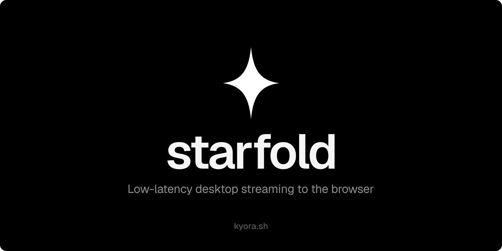

<p align="center">
  <a href="LICENSE"></a>
  <a href="https://github.com/kyora-sh/starfold/actions/workflows/ci.yml"></a>
</p>


kyora starfold streams a desktop to a plain browser tab over one WebSocket: an X11 display (Xvfb
included), a Mac's screen or a Windows desktop. The browser decodes with WebCodecs. The default
encoder is AV1 from libaom, built in; on a host with a hardware H.264 encoder that isn't
experimental (VideoToolbox on a Mac) it is that one, and the server and the browser negotiate HEVC or AV1 where both have them. It carries the
mouse, keyboard and touch, the clipboard, audio and the microphone, file transfer and dynamic resolution.
Agents get HTTP APIs for screenshots, recordings, input and waiting until the screen settles.

## Quick start

```sh
cargo install --locked --path crates/starfold-server   # needs libyuv, Opus, PulseAudio, esbuild, cmake and nasm (see Build)
DISPLAY=:1 starfold         # streams display :1 and prints a link that signs you in
```

Open the link it prints. On a Mac or a Windows PC, `starfold` streams that machine's own screen
instead; see [macOS](#macos) and [Windows](#windows).

## Install

### Prebuilt binaries

Each [release](https://github.com/kyora-sh/starfold/releases) attaches two builds per platform
(`<version>` is the release's, e.g. `0.3.2`; [Licensing](#licensing) has the details):

- **Default** (`starfold-<version>-<platform>`): where the host has no hardware H.264 encoder, it
  streams AV1 from libaom, which is linked in statically. Viewers need a protocol 2 client that
  decodes AV1 (see [Which browsers](#faq)). It is distributed under MIT. Like any program built with GCC, the Linux and Windows binaries include GCC's runtime code
  (its startup files on Linux; also the C++ runtime libraries on Windows), which is
  GPL-3.0-or-later with the GCC Runtime Library Exception: the exception is what lets the binary be
  distributed under MIT. Linux binaries also include glibc's startup files, which are
  LGPL-2.1-or-later with permission to link them into any program. These texts are in the
  `licenses/` of the archives they apply to: GCC's in the Linux and Windows ones, glibc's in the
  Linux ones.
- **x264** (`starfold-x264-<version>-<platform>`): adds x264, so where the host has no hardware
  H.264 encoder the base stream (recordings, protocol 1 viewers, browsers without AV1) is H.264
  from x264, while browsers that decode AV1 still get AV1 from libaom; with `--encoder x264` every
  viewer gets x264. GPL-2.0-or-later as a combined work with x264, whose source the release
  attaches beside it.

| Platform              | Default (MIT)                             | x264 (GPL-2.0-or-later)                        |
| --------------------- | ----------------------------------------- | ---------------------------------------------- |
| Linux x86_64          | `starfold-<version>-x86_64-linux.tar.gz`  | `starfold-x264-<version>-x86_64-linux.tar.gz`  |
| Linux aarch64         | `starfold-<version>-aarch64-linux.tar.gz` | `starfold-x264-<version>-aarch64-linux.tar.gz` |
| macOS (Apple silicon) | `starfold-<version>-aarch64-macos.tar.gz` | `starfold-x264-<version>-aarch64-macos.tar.gz` |
| Windows x86_64        | `starfold-<version>-x86_64-windows.zip`   | `starfold-x264-<version>-x86_64-windows.zip`   |

Download an archive and its `.sha256`, check it and unpack it:

```sh
sha256sum -c starfold-<version>-x86_64-linux.tar.gz.sha256   # macOS: shasum -a 256 -c ...
tar -xzf starfold-<version>-x86_64-linux.tar.gz
./starfold-<version>-x86_64-linux/starfold --version
```

`--version` names the version, the software encoders in the binary and the licence it is
distributed under: `starfold <version> (encoders: libaom; licence: MIT)` or
`starfold <version> (encoders: x264, libaom; licence: GPL-2.0-or-later)`. Each archive also holds `LICENSE`,
`THIRD_PARTY.md` and `licenses/`: the licence texts of the Rust crates and Rust standard library
compiled into the binary, of what `THIRD_PARTY.md` lists for that platform, and of each library or runtime object
linked in statically (libaom; glibc's and GCC's startup files on Linux; Opus on macOS and
Windows; libyuv, the MinGW-w64 runtime and GCC's runtime libraries on Windows). The x264 archives
add `COPYING` (GPL-2.0) and `X264-SOURCE.txt`.

What each platform needs at run time:

- **Linux** (built on Ubuntu 24.04, so it needs a distribution at least that new): libyuv, Opus and
  PulseAudio's client library, plus x264 for the x264 build. On Ubuntu 24.04:
  `sudo apt install libyuv0 libopus0 libpulse0` for `starfold-*`, plus `libx264-164` for
  `starfold-x264-*`. Plus an X server to stream, such as Xvfb (see [Usage](#usage)).
- **macOS**: nothing beyond the system; Opus and libaom are linked in, and x264 in the x264 build. The binary is not notarized,
  so clear the download quarantine first: `xattr -d com.apple.quarantine starfold`.
- **Windows**: nothing beyond the system; `starfold.exe` is self-contained.

### With npm or pip

The server packages install the default build's binary with them on Linux x86_64 and aarch64,
macOS (Apple silicon) and Windows x86_64: npm's `@starfold/server` through a binary package for
the platform (`@starfold/server-linux-x64-gnu`, `-linux-arm64-gnu`, `-darwin-arm64`,
`-win32-x64`), PyPI's `starfold-server` through a platform wheel. Each binary is the release
archive's, with its `LICENSE`, `THIRD_PARTY.md` and `licenses/`.

```sh
npm install @starfold/server && npx starfold --version
pip install starfold-server && starfold --version
```

Both can start a server from code (`startServer()` from `@starfold/server` in TypeScript,
`start_server()` from `starfold_server` in Python) on loopback with a generated password, and give
a client already signed in to it; see [packages/server](packages/server/README.md) and
[python/starfold-server](python/starfold-server/README.md). On other platforms `@starfold/server`
installs without a binary and PyPI has no `starfold-server` wheel; set `STARFOLD_BIN` to a
starfold binary built for it, or use a client against a server running elsewhere. The client alone is npm's `starfold`
([packages/starfold](packages/starfold/README.md)), with no dependencies and no binary, and PyPI's
`starfold` ([python/starfold](python/starfold/README.md)), with no binary and no `starfold` command.

On Linux the server uses the system's libyuv, Opus and PulseAudio libraries and needs glibc 2.39
or newer (Ubuntu 24.04 or newer):

```sh
sudo apt install libyuv0 libopus0 libpulse0
```

### From source

Rust (CI builds with 1.93), a C++ compiler, clang, pkg-config, esbuild and the native libraries; on
Ubuntu 24.04:

```sh
sudo apt install build-essential clang libclang-dev pkg-config esbuild cmake perl nasm \
  libyuv-dev libopus-dev libpulse-dev libxcb1-dev
cargo install --locked --git https://github.com/kyora-sh/starfold starfold
```

That is the default build, with libaom and under MIT; `--tag v<version>` installs a release
instead of main's head. For x264, add `--features x264` and install `libx264-dev`; that binary is
GPL-2.0-or-later. On a Mac, `brew install opus pkgconf esbuild cmake nasm` (plus `x264` for
`--features x264`) gives the libraries; Windows builds with vcpkg (see
[Windows](#windows)). [Build](#build) has the details, and a Nix shell with everything.

## Benchmarks

[`bench/results/2026-11-starfold-vs-novnc.md`](bench/results/2026-11-starfold-vs-novnc.md) measures
starfold against noVNC as kyora runs it, on kyora VMs at 1920x1080 with a 30 fps source, on the LAN
and on 20 and 2 Mbit/s links with 50 ms RTT: frame rate, key-to-paint latency, picture quality against
the X server's own pixels, and bandwidth. The sets of its
[8 November refresh](bench/results/2026-11-starfold-vs-novnc.md#refresh-8-november-2026-13-against-main)
interleave the arms on one VM and carry an A/A arm, so a difference there only counts beyond what the
same binary shows against itself; the file's earlier sets and macOS jobs don't all have those
controls, and each says which it has. The harness is in [`bench/vs/`](bench/vs) and the method,
caveats and raw cells are in the results file.

## Build

Rust, a C++ compiler, clang, pkg-config, libyuv, libopus, libpulse and esbuild;
`nix-shell --arg withRust true` provides them all (plain `nix-shell` all but Rust, for your own
toolchain).

The default software encoder is libaom (BSD-2-Clause), for AV1 (the `libaom` feature, on by
default; `--encoder libaom`). It is built from source, libaom v3.15.3 at commit
`b141d9c45db236335351c8a4b2a14b3ade27c937`, which is the git submodule
`crates/starfold-aom-sys/aom`, and is linked statically, so no system libaom is used and the
binary stays under MIT. That build also needs git, cmake 3.16 or newer, perl and, on x86_64, nasm
(or yasm); the build stops before compiling and names any that are missing:

| System         | Install                                                                          |
| -------------- | -------------------------------------------------------------------------------- |
| Debian, Ubuntu | `sudo apt install cmake perl nasm libclang-dev`                                  |
| Fedora         | `sudo dnf install cmake perl nasm clang-devel`                                   |
| macOS          | `brew install cmake nasm` (perl and libclang come with `xcode-select --install`) |

Clone with the submodule (`git clone --recursive`, or `git submodule update --init` in an existing
clone). The build checks that the submodule is at that commit with no file changed, so it needs
the submodule's git metadata: GitHub's "Download ZIP" and its automatic source archives contain
neither the submodule nor that, and can't build libaom.

H.264 in software is x264, an optional feature: `--features x264` adds it (`--encoder x264`) and
makes it the base stream's encoder where there is no hardware H.264 one. It needs the x264
library (`libx264-dev` on Debian and Ubuntu, `brew install x264` on a Mac, or
`x264` in vcpkg on Windows), builds on x86_64 and aarch64 only (on other architectures the
feature refuses to build), and makes the binary GPL-2.0-or-later (see [Licensing](#licensing)).

A build without an H.264 encoder (the default, on a host without hardware H.264) closes a
protocol 1 viewer, which decodes only H.264, with WebSocket close code 4406 and a reason that names AV1 and the protocol 2 client. To keep protocol 1
viewers, build with `--features x264` or run where a hardware H.264 encoder is found.

```sh
nix-shell --arg withRust true
cargo build --release
```

Or install it with the same libraries on your system (the package in `crates/starfold-server` is
`starfold`, and so is the binary):

```sh
cargo install --locked --path crates/starfold-server
```

## Usage

Run it against an X display, then open the link it prints (`?stats` adds an FPS overlay,
`?present=canvas` paints into a canvas instead of `<video>`; a page embedding it can wait for the
`starfold:firstframe` event on `window` rather than `load`):

```sh
DISPLAY=:1 ./target/release/starfold --port=6901
# prints: open http://localhost:6901/?token=4f1c… to sign in
```

Use the patched Xvfb (`nix-build -E 'with import <nixpkgs> {}; callPackage ./xvfb.nix {}'`) for
pixel-precise scroll input; stock Xvfb scrolls by wheel notches. `starfold --help` lists every flag
with its default, and `starfold --version` prints the version.

starfold captures X11 with MIT-SHM GetImage into a 0600 shared-memory segment of its own. The X
server has to attach that segment, which it can't over TCP (`DISPLAY=host:N`; use `DISPLAY=:N`),
from another IPC namespace, or as another user: starfold then stops at start and names these
causes. After the attach it checks that the server writes into its segment, not into another
one with the same id on the server's side.

With `STARFOLD_DIRECT_FB=1` in its environment and Xvfb started with `-shmem`, starfold reads the
screen in place from Xvfb's framebuffer instead. On one VM (4 vCPUs, a 1920x1080 full-screen
animation at 60 fps) that saved about 1 ms per frame and about a tenth of a core; both paths kept
60 fps. `STARFOLD_NO_DIRECT_FB` turns it off and wins over `STARFOLD_DIRECT_FB=1`. A segment is
read only if all of these hold, else starfold uses GetImage and logs why once:

- the X connection is a local socket whose peer credentials give the X server's pid, and
  `/proc/self` is this process;
- after starfold attaches the segment, it was created by that pid, has the size listed, and that
  pid maps it now (the same device and inode in `/proc/<pid>/maps` as starfold's own mapping);
- its XWD header names the screen being served (Xvfb writes `Xvfb <host>:<display>.<screen>`) and
  the image fits in the segment;
- a strip of its pixels matches what the X server returns for that screen.

Its known limits:

- A stale segment whose creator's pid number the live X server now holds passes if that server
  maps it (a client can make it attach one through MIT-SHM).
- The X server's maps are read before starfold attaches the segment.
- `/proc` is checked by pid number: an ancestor pid namespace's `/proc` in which this process has
  the same number passes.
- Whatever answers on the X connection (a relay, a process holding the socket's name) is trusted,
  as on every capture path.

Xvfb creates its `-shmem` segments with mode 0777: every local user can read that screen, whether
starfold reads it or not. On a host with several users, don't start Xvfb with `-shmem`.

| Flag                                                           | Default                                                               |                                                                                                                                                                                                           |
| -------------------------------------------------------------- | --------------------------------------------------------------------- | --------------------------------------------------------------------------------------------------------------------------------------------------------------------------------------------------------- |
| `--addr`, `--port`                                             | `0.0.0.0`, `6901`                                                     | listen address                                                                                                                                                                                            |
| `--display`                                                    | `$DISPLAY`                                                            | X display to stream when `DISPLAY` is unset                                                                                                                                                               |
| `--title`                                                      | `starfold`                                                            | the page's title: the browser tab, and the app's name if a viewer installs it                                                                                                                             |
| `--favicon`                                                    | starfold's icon                                                       | the tab's icon: an `.ico`, `.png`, `.gif`, `.webp` or `.svg` file                                                                                                                                         |
| `--enable-basic-auth`                                          | `true`                                                                | ask for a password (see [Login](#login)); `false` serves without one                                                                                                                                      |
| `--basic-auth-password`                                        | `STARFOLD_PASSWORD`, else `SELKIES_BASIC_AUTH_PASSWORD`, else made up | the password                                                                                                                                                                                              |
| `--basic-auth-user`                                            | any                                                                   | the user name a browser's sign-in has to give                                                                                                                                                             |
| `--framerate`                                                  | `60`                                                                  | max frames per second (`60-60` style ranges accepted)                                                                                                                                                     |
| `--high-fps`                                                   | `false`                                                               | hardware VideoToolbox streams take 120 frames per second (or `--framerate` if higher); other encoders take `--framerate` up to 60                                                                         |
| `--encoder`                                                    | `auto`                                                                | hardware, unless experimental; the base stream from hardware H.264, else x264 (if built), else libaom (AV1); or `libaom`, `x264`, `videotoolbox`; experimental `vaapi`, `nvenc`, `mediafoundation`, `qsv` |
| `--encoder-probe`                                              | `true`                                                                | probe the hardware encoders at startup (`/stats` lists what was found)                                                                                                                                    |
| `--experimental-hw-probes`                                     | `false`                                                               | also probe VA-API, NVENC, Media Foundation and Quick Sync, each in a child process; needed to name one with `--encoder`, which `auto` never picks                                                         |
| `--preset`                                                     | `ultrafast`                                                           | the preset or speed of the encoder `--encoder` names (under `auto`, of the software base one); others keep their default; `--help` lists what each built-in encoder takes                                 |
| `--encoder-threads`                                            | `ncpu/4`, from 1 to 4; libaom: 4 or 8                                 | sliced encoder threads; libaom takes 4 up to 1080p and 8 above, at most the CPUs but never under 2 (see [Encoder threads](#encoder-threads))                                                              |
| `--crf`                                                        | `24`                                                                  | x264's base quality; libaom's and most bench arms' lowest quantizer or QP; a hardware encoder's constant QP when it runs one (`--max-kbps 0`, or as VA-API's driver allows)                               |
| `--max-kbps` / `--video-bitrate`                               | `30000`                                                               | adaptive bitrate ceiling                                                                                                                                                                                  |
| `--min-kbps`                                                   | `2000`                                                                | adaptive bitrate floor                                                                                                                                                                                    |
| `--paintover-crf`, `--paintover-burst`, `--paintover-delay-ms` | `16`, `3`, `150`                                                      | sharpening when the screen goes still (`--paintover-crf` reaches x264, libaom, the libvpx arm if built in, and a hardware encoder at constant QP; also the finest QP x264 refines to, default 12)         |
| `--enable-clipboard`                                           | `true`                                                                | `true`, `in`, `out` or `false`                                                                                                                                                                            |
| `--audio-enabled`, `--audio-device-name`, `--audio-bitrate`    | `true`, `output.monitor`, `128000`                                    | desktop audio                                                                                                                                                                                             |
| `--enable-resize`, `--resize-scale`                            | `false`, `1.5`                                                        | desktop follows the viewer's window; desktop pixels per CSS pixel                                                                                                                                         |
| `--microphone-enabled`, `--microphone-fifo`                    | `false`, `/tmp/starfold-mic.fifo`                                     | browser microphone into the FIFO a PulseAudio pipe source reads                                                                                                                                           |
| `--round-corners`                                              | `0` (off)                                                             | corner radius in pixels for top-level windows                                                                                                                                                             |
| `--round-windows`                                              | none                                                                  | `title:radius,...` rounds windows with that title, docks included                                                                                                                                         |
| `--adaptive-threads`                                           | `false`                                                               | encode on one thread, fanning out only under sustained heavy motion                                                                                                                                       |
| `--stored-screens`                                             | `true`                                                                | libaom keeps up to six settled screens and codes a return to one from it; `false` turns that off                                                                                                          |
| `--stripes`                                                    | `1`                                                                   | encode the screen as N independent horizontal streams (experimental)                                                                                                                                      |
| `--scroll-px-per-notch`                                        | `180`                                                                 | desktop pixels one wheel notch scrolls (calibrates smooth scrolling)                                                                                                                                      |
| `--file-transfers`                                             | `upload,download`                                                     | `upload`, `download`, both, or `none`; under `--read-only` uploads stay off, and naming `download` (alone or as `upload,download`) turns on listing and downloads                                         |
| `--read-only`                                                  | `false`                                                               | a viewer cannot change the desktop, file contents or recordings; files are listed and downloaded only when `--file-transfers` names `download`; watching still influences delivery as any viewer does     |
| `--allowed-hosts`                                              | none                                                                  | host names to answer for besides IP addresses and `localhost` (`.example.com` covers subdomains, `*` any)                                                                                                 |
| `--allowed-origins`                                            | none                                                                  | other sites whose pages may connect, such as a page that embeds starfold's client (`*` any site)                                                                                                          |
| `--base-path`                                                  | none                                                                  | serve everything under this path prefix (such as `/desktop`), for a reverse proxy that forwards it unchanged; see [Hosts and origins](#hosts-and-origins)                                                 |
| `--files-root`                                                 | (none: no file transfer)                                              | folder the Files panel can see; see [File transfer](#file-transfer)                                                                                                                                       |
| `--upload-dir`                                                 | `Downloads`                                                           | folder, relative to the root, the panel opens and uploads into; created on first upload                                                                                                                   |
| `--max-upload-mb`                                              | `0` (no limit)                                                        | largest accepted upload                                                                                                                                                                                   |
| `--max-record-seconds`                                         | `300`                                                                 | longest recording (`/record`); at most 600 with `--enable-recording`                                                                                                                                      |
| `--enable-recording`                                           | `false`                                                               | allow `/record`; at most 2 at once, each written to `--recording-dir` as it runs; with no viewer of the base stream it runs that encode of its own (see below)                                            |
| `--recording-dir`                                              | `/var/tmp` on Linux, else the system temporary folder                 | where recordings are written, in files with no name; refused if it is memory (tmpfs, ramfs) and, at startup, if it is inside `--files-root`                                                               |
| `--convert-threads`, `--coalesce-us`                           | `4`, `0`                                                              | tuning                                                                                                                                                                                                    |

### Encoder threads

Unless `--encoder-threads` is given, libaom picks its own thread count from the picture size and
the host's CPUs: 4 for a picture up to 1080p, 8 above it (1440p, 4K), at most the CPUs, but never
under 2 per encoder (so 2 on a 1-CPU host); two libaom encoders running at once share the CPUs,
each with at least 2, so together they can take more threads than there are CPUs.
4K at 30 fps with libaom needs 8 or more CPUs. On fewer, the server sends fewer frames: it never
queues captures behind a slow encode (one running, at most one waiting), skips the rest and
carries what changed in them into the next frame. Other software encoders take `ncpu/4` threads,
from 1 to 4.

### File transfer

File transfer is off unless `--files-root` names a folder. The Files panel then resolves
every path it is given beneath that folder and refuses a path through a symlink, subject to
the limits below.

- An upload is written to a hidden `.starfold-upload-*` file and renamed when complete, never
  over an existing file; a name taken meanwhile gets 409.
- After a crash, hidden `.starfold-upload-*` files may remain in the upload folder. They can be
  deleted when no starfold is running.
- A filesystem with neither an exclusive rename nor hard links refuses uploads (501).
- Hiding those temporary files is best effort: on filesystems with short names (FAT), a
  signed-in viewer may be able to see an upload while it is in progress.
- A path longer than `PATH_MAX` is refused before anything is created, and an upload needs room
  for a 255-byte name under it.
- On Linux and macOS, an upload is saved into the folder it was opened in, even if that folder
  is moved (inside the root or out of it) before the upload completes. On Windows such an
  upload may fail and leave its temporary file in the moved folder.
- On Unix systems other than Linux and macOS, an entry's own name can't be looked up, so only
  the name in the request is checked, and the root's length is measured at the path it was
  started with.
- On Windows a path is checked and then opened by name, so a folder changed in between can
  affect what is opened.
- With `--read-only`, uploads are refused whatever `--file-transfers` says, and the panel lists
  and downloads files only when `--file-transfers` names `download` (`--file-transfers=download`,
  or `--file-transfers=upload,download`, where uploads stay off). Viewers then cannot change a
  file's contents, but reading one may update its access time, as any read does on a filesystem
  mounted with `strictatime`.
  **Behaviour change:** a server started with `--read-only` and `--files-root` but no
  `--file-transfers` used to hand out files; it no longer does until `--file-transfers=download`
  is added.

### Login

starfold asks for a password before it shows the desktop or takes input, files or API
calls. Give it one with `--basic-auth-password`, `STARFOLD_PASSWORD` or `SELKIES_BASIC_AUTH_PASSWORD`;
otherwise it makes one up when it starts and prints a link that signs you in. There are three ways in:

- **The link**: `http://host:6901/?token=<password>`. The page passes the password on to
  its own connections, so the link also works as an iframe's `src`.
- **The browser's sign-in prompt**, which starfold's page brings up: any user name (unless
  `--basic-auth-user` names one) and the password. Password managers offer to save it.
- **For programs**: `Authorization: Bearer <password>`, or `curl -u :<password>`.

The page's scripts and `/healthz` load without it. If starfold sits behind a proxy that signs
people in itself, `--enable-basic-auth=false` turns starfold's login off.

### Hosts and origins

starfold only answers requests for an IP address or `localhost`, and only from its own page.
That keeps out other web pages, which browsers let connect to any address, including
pages whose domain is pointed at starfold's address (DNS rebinding). To reach starfold under a
host name, such as through a proxy or as `my-pc.local`, name it with `--allowed-hosts`.
To let a page on another site connect, name that site with `--allowed-origins`.
Programs that aren't browsers (curl, scripts, agents) send no `Origin` and connect as
usual. A refused request gets a 403 that names the flag to add.

A proxy that serves starfold under a path, such as `https://example.com/desktop/`, and
forwards the path unchanged needs `--base-path=/desktop`. starfold then serves its pages
under `/desktop/` only and prints its link with the prefix. Every request, `/desktop`
itself included, goes through the same host, origin and password checks as without a
prefix; once they pass, `/desktop` is sent on to `/desktop/` and paths outside the prefix
are not found. A proxy that strips the prefix before forwarding needs no flag, but has to
send `/desktop` on to `/desktop/` itself: the page's URLs are relative, so from
`/desktop` they would resolve at the site's root.

Give `--base-path` once, with a prefix such as `/desktop` (letters, digits, `.`, `_`, `~`
or `-` between single slashes, at most 1024 bytes; one trailing slash is dropped). Given
twice, without a value, empty, `/` or in any other shape, the server does not start: it
exits with code 2 and says why on stderr, even beside `--help` or `--version`; leave the
flag out to serve at the root. (This is about starting the server; the encoder-probe child
the server runs for itself opens no listener and ignores the flag.) The prefix is part of every request line, so it counts against the length a
request line may have (64 KiB in starfold, often less in a proxy).

### Embedding: reconnecting

The embeddable client (`mount()` in `packages/web/src/embed`) reconnects only when asked to:
`reconnect: true` takes the defaults below, an object sets them
(`{ initialMs, factor, capMs, maxAttempts, maxMs, shouldReconnect }`). It does what a careful
host would: the same `connect()`, with the preamble called again for every attempt, so a
ticket is minted for each. Each close still reaches `onClose`; then `onStatus('reconnecting')`
and `onReconnect({ kind: 'reconnecting', attempt, delayMs, code })`, an attempt (`connecting`,
`open`, then `onReconnect({ kind: 'reconnected', attempt, code })`), or, once it stops,
`onStatus('gave-up')`, `onReconnect({ kind: 'gave-up', why, code })` with the last close's code,
and `onStatus('closed')`. The close's reason, the server's or a gateway's own text, goes only to
`onClose` and `shouldReconnect`.

| Close code            | Sent by                                                                                                       | Reconnects                                                                                   |
| --------------------- | ------------------------------------------------------------------------------------------------------------- | -------------------------------------------------------------------------------------------- |
| 1006 (no close frame) | the browser: a network drop, a server that crashed or was killed, or an upgrade the server refused (401, 403) | yes; three in a row that never reached open give up (`never-opened`)                         |
| 1001, 1012, 1013      | a server or proxy going away, restarting, or busy                                                             | yes                                                                                          |
| 44xx (but 4406)       | the host's gateway (4401: a ticket missing or rejected) or a server                                           | yes; the same code twice in a row, each within 10 s of its open, gives up (`repeated-close`) |
| 4406                  | starfold: a protocol 1 viewer when the base stream is not H.264                                               | no                                                                                           |
| 1000                  | a server or proxy closing on purpose                                                                          | no                                                                                           |
| 1003, 1007, 1009      | starfold: a frame the client should not have sent                                                             | no                                                                                           |
| 4000, 4001, 4002      | the client itself: a protocol error, no common codec, a failed worker                                         | no                                                                                           |
| any other             |                                                                                                               | no                                                                                           |

A starfold server that shuts down (SIGTERM, SIGINT, Ctrl-C) queues 1012 for every viewer after
what is already queued for it and exits about 1.2 s later at most; a viewer too far behind to
read it by then sees 1006.

`shouldReconnect(code, reason)` replaces the table; the limits still apply. It is called at
once, not queued; one that throws counts as no. The delay before attempt n is a random time
below min(`capMs`, `initialMs` x `factor`^(n-1)) (defaults 500 ms, 2, 30 s), and a run gives up
after `maxAttempts` attempts (10) or `maxMs` since its first close (5 min, on the wall clock:
time hidden, offline or asleep counts), whichever comes first; it gives up at that deadline even
while it waits, and a reply that would go out past it is not sent. A limit that is not a
positive number (`maxAttempts` a whole one, `factor` at least 1) makes `mount()` throw. A
connection that stays open for 10 s, timed by the worker that holds the socket, ends the run.
A hidden tab waits to be visible again and an offline page for the network, then connects at
once; a page that is or goes offline during the delay connects as soon as it is back, delay or
not. A reconnect attempt sends its preamble's messages only while the page is visible and
online, even if it went hidden or offline while the preamble was pending (the check is made as
the page hands them to the worker, so a tab hidden in that same instant can still connect). A
reconnect attempt whose preamble fails, or whose socket can't be made, gives up
(`preamble-failed`, `connect-failed`); a preamble that never settles leaves the attempt waiting
until the deadline, as the host's own `connect()` would wait. The host's own `connect()` while
waiting connects at once and starts the count over; `unmount()` cancels it.

### For agents and scripts

Screenshots and recordings (start starfold with `STARFOLD_PASSWORD` set, and send it along;
recordings also need `--enable-recording`):

```sh
# the screen as a PNG
curl -u ":$STARFOLD_PASSWORD" -o shot.png localhost:6901/screenshot
# an MP4 of the next 10 s
curl -u ":$STARFOLD_PASSWORD" -o clip.mp4 "localhost:6901/record?seconds=10"
# or start...
id=$(curl -u ":$STARFOLD_PASSWORD" -s -X POST localhost:6901/record/start | jq -r .id)
# ...and stop when done
curl -u ":$STARFOLD_PASSWORD" -o clip.mp4 -X POST "localhost:6901/record/stop?id=$id"
```

**Breaking change:** recording is off unless starfold runs with `--enable-recording`; without it
the three `/record` routes answer 403 (`"recording": false`). A recording's id is now a
32-character string: scripts need `jq -r .id` where they had `jq .id`.

Only a holder of the id that start returned can stop a recording or obtain its clip. The id
is returned once, to the caller of start, over the same authenticated channel; it is 128 bits
from the OS and compared in constant time. Treat the id like a secret: anyone who has it and
can reach the server can stop the recording and take the clip.

Under `--read-only` the three routes are refused even with `--enable-recording`.

A recording is the stream starfold sends to viewers, saved as MP4 without re-encoding: H.264
(`avc1`) from an H.264 encoder, AV1 (`av01`, ISO/IEC 14496-12 with the AV1 codec ISO media
file format binding) from an AV1 one, so with the default build on a host without hardware
H.264 it is AV1. An AV1 MP4 plays in current Chrome, Edge and Firefox, in VLC and mpv, and with
ffmpeg; Safari and QuickTime play it only on a Mac or iPhone whose hardware decodes AV1 (Apple
M3 or A17 Pro and later), so on an older Mac open it in a browser other than Safari or in VLC,
or convert it with `ffmpeg -i clip.mp4 -c:v libx264 clip-h264.mp4`.
The recorded encode is the base stream: the one a protocol 1 viewer gets when it is H.264. It
takes each encoded frame beside the viewers, never as one of them, so it has no part in their
flow control, their frame rate or their bitrate. With viewers taking that stream it shares their
encode and adds none. With none, it keeps that encode running while it lasts, at up to `--framerate` frames a second and at a bitrate target of its
own: that encode's CPU is the cost of recording an unwatched screen. With x264 at 1920x1080
and full-screen motion at 60 Hz it was about 50 % of one core on a 6-vCPU VM, against under
1 % with nothing recording. It needs a single-stripe stream: `--stripes=1`, and a picture the
encoder doesn't split into stripes on its own (it does for a picture too large for one; then
a start gets 409, and a recording running when the split comes ends with `closed`). A frame
of another size (a resize) ends it. It doesn't include the cursor, which viewers draw, except on macOS
when the cursor is in the video: with `--show-cursor` (the default with `--read-only`), or when the system cursor can't be read.

A recording starts at a keyframe. It asks the base encode for one through the viewers' own
flow control: the keyframe comes with the first frame every viewer of that encode has room
for, so a viewer that is behind gets no extra keyframe. With no viewer behind, that is the
next capture; with one behind, as soon as it has caught up (or after 4 s, when the server
gives up on it and sends it a keyframe of its own).

While it runs, a recording's video goes to a file with no name in `--recording-dir`, and the
answer is read back from that file:

- At most 2 recordings run at once (`/record` and `/record/start` alike), a third gets 429.
  A recording keeps its place until its answer is dropped (sent, or its client gone), or
  until it ends with no answer to give.
- Each recording reserves the disk space it may fill when it starts: up to 2 GiB, out of the
  free space above the floor (min(1 GiB, 10 %) of the filesystem) that the other recording
  has not reserved. With less than 64 MiB of that room it gets 507 (`disk_space`); with less
  than 2 GiB it records up to what it reserved (`size_limit`). So recordings take at most
  4 GiB of `--recording-dir` together and never take it below the floor themselves. Another
  program writing there can: a recording looks again after half the room that was left (at
  most 64 MiB later) and ends with `disk_space` below the floor. A recording also ends at 120
  frames a second of its length (`frame_cap`).
- `--max-record-seconds` is at most 600 with `--enable-recording` (the server refuses to
  start above it). In memory a recording holds the frames waiting for the disk (at most
  4 MiB, or one frame of up to 8 MiB when nothing else waits), the writer's 256 KiB buffer,
  and 16 bytes a frame, as frames come, up to 120 frames a second of its length (576 KB at
  300 s, 1.15 MB at 600 s); its answer's MP4 header holds up to as much again for its
  tables. At most 10 MiB per recording at any length. A disk that falls further behind ends
  it with `disk_slow`; a frame over 8 MiB ends it with `large_frame`.
- A write that takes 10 s ends the recording with `disk_slow` and gives its place back at
  once. The stuck write keeps its file, the space that file reserved, its buffer and its
  queue until the disk returns. A write that fails is seen when the writer's buffer is next
  written out (every 256 KiB) or when the recording ends.
- An answer whose client takes no bytes for 30 s is dropped, and the recording's place with
  it. A started recording nobody stops is dropped 60 s after it ended. A `/record` request
  whose client goes away ends its recording.

If another encoder takes over mid-recording (a hardware encoder failing over to the
software one, say, or one codec taking over from the other), the recording continues in a
new MP4, up to 16 of them. Add `format=zip` to
`/record` or `/record/stop` for all of them: `segment-1.mp4`, `segment-2.mp4`, ... and a
`manifest.json` with each one's `start_ms`, `duration_ms` and `frames`, and the
`end_reason` (`stopped`, `time_limit`, `resized`, `segment_cap`, `bad_parameter_sets`,
`bad_frame` (a frame no MP4 sample can be made of), `segment_lost`, `closed`, `size_limit`, `frame_cap`, `large_frame`, `disk_slow`,
`disk_space` or `disk_error`). Without it you get the first MP4. Every answer says how many
MP4s there were and why the recording ended, in `x-starfold-segments` and
`x-starfold-record-end`; one with no video is JSON with the `error` and the `end_reason`. A zip
answer has no `Content-Length`: it is written as it is sent.

`/wait` returns when the screen settles or changes, so an agent doesn't have to sleep
after every action and hope it was long enough:

```sh
# once nothing changed for 300 ms
curl -u ":$STARFOLD_PASSWORD" localhost:6901/wait
# still for 1 s, giving up after 30 s
curl -u ":$STARFOLD_PASSWORD" "localhost:6901/wait?idle=1000&timeout=30000"
# the first change in that rectangle
curl -u ":$STARFOLD_PASSWORD" "localhost:6901/wait?change&region=0,0,800,600"
# {"changed":true,"timed_out":false,"seq":812,"waited_ms":340}
```

`idle` (ms, default 300) is how long the screen has to stay still, counted from the
request at the earliest so an action just taken has time to show; `change` returns at
the first change instead. `region=x,y,w,h` only watches that rectangle (to the 16-pixel
block) and `timeout` (ms, default 10000) gives up. `changed` says whether anything
changed while waiting. A change can land before the request does, so to wait for what an
action caused, pass `since` the `seq` of an earlier `/wait` or the `X-Starfold-Seq` header of
a screenshot: `/wait?change&since=812` returns at once if anything changed after it. A
blinking text caret redraws about twice a second, so keep `idle` under 500 ms or leave
the caret out of `region`. starfold already knows which parts of the screen change (XDamage,
ScreenCaptureKit and DXGI report them), so waiting needs no screenshots or polling.

`POST /input` drives the mouse and keyboard with JSON actions (one, or an array applied in
order) and answers with the `seq` from before them, so `/wait?change&since=` sees what they
did. A `--read-only` server refuses it with 403. `python/starfold` wraps all of this.

With `--read-only` a viewer cannot change the desktop, file contents or recordings: every
route and message is decided in one table, and anything not in it is refused. Watching still
influences delivery as any viewer does (keyframe requests, its refresh rate, its
acknowledgements).

```sh
curl -u ":$STARFOLD_PASSWORD" -H 'Content-Type: application/json' localhost:6901/input \
  -d '[{"type":"click","x":400,"y":300},{"type":"type","text":"hello\n"},{"type":"key","key":"ctrl+s"}]'
# {"seq":812,"events":19}
```

### On a unix socket (Linux only)

`--listen-unix DIR` serves the same routes, with the same login and host checks, on a
unix socket: starfold makes `DIR` for its user alone (mode 0700), or takes one it left
behind, and listens on `DIR/s`; `--listen-tcp=false` turns TCP off. On other platforms the flag is
refused: `--listen-unix is not available on this platform yet`. It binds before any
thread starts, so it works from the `starfold` binary or a program whose own `main` calls
`starfold::main` first thing (the bind checks that the process has one thread);
`starfold::run` refuses it.

What keeps other users out, in three parts:

- **Every accepted peer has starfold's uid.** The kernel records each connecting
  process's credentials at `connect`, and starfold reads them (`SO_PEERCRED`) before it
  reads or writes a byte, closing any connection from another uid.
- **That uid is exact.** In a user namespace whose uid map is the identity (the initial
  namespace, or one root gave the same map) every uid is mapped; elsewhere an unmapped
  peer reads as the overflow uid, which could be starfold's own. So at start starfold
  reads `/proc/self/uid_map` (from procfs, checked with `fstatfs`, through no mount
  point) and refuses `--listen-unix` unless it is the full identity map,
  `0 0 4294967295`, before anything is made; the refusal quotes what it read. This needs
  Linux 5.6 or later (`openat2`) built with user namespaces (`CONFIG_USER_NS`, which
  gives the file).
- **Nobody else can substitute the path while starfold binds it.** Before it makes `DIR`,
  starfold walks the path from `/`, one directory at a time without following symlinks
  on its own: every directory on the way must belong to starfold's user or root and let
  no other user rename entries in it (writable by no one else unless sticky, as `/tmp`
  is, and no ACL entry that lets anyone else write). A symlink on the way is followed
  only if it belongs to starfold's user or root, and its target is held to the same
  rules. No directory on the way, and not `DIR`, may be on procfs (`/proc/self/cwd`, say,
  resolves differently for each process) or on another user's FUSE mount (its daemon
  reports owners and modes as it likes). A directory on a FUSE-type filesystem is judged
  by its mount (its line in `/proc/self/mountinfo`, found by `statx` mount id and read
  through the checked procfs): virtiofs is taken, as is a `fuse`/`fuseblk`/`fuse.*` mount
  whose `user_id=` is root's or starfold's user's (a FUSE mount of root's is the
  administrator's, like a root-owned directory); any other, or one that can't be found,
  is refused. This needs a kernel that gives mount ids (Linux 5.8 or later) for any FUSE
  directory on the path. An existing `DIR` is taken only if it is a real directory (not a
  symlink) of starfold's user with mode exactly 0700 (or 02700, as under a setgid
  parent), and starfold holds a lock on it (`flock`) for as long as it serves, so a
  second instance on it is refused. In it, an existing `s` is replaced only if it is a
  socket of starfold's user that refuses a connection (nothing listens on it); anything
  else there, or at `DIR`, is refused. A server that has just died can leave `DIR` held
  for a moment by a child it forked that has not yet started its program (the child's
  copies of the lock and the listening socket close when it does); a restart in that
  moment is refused as another server using it, which fails safe, and once the child has
  started its program `DIR` can be taken back as above. Any refusal names the directory,
  symlink or entry at fault, with its owner and mode, and touches nothing of someone
  else's.

The socket's mode decides who reaches `connect` at all. With the default
`--listen-unix-mode=0600` no other uid can connect: the kernel refuses it. That holds
for ordinary processes; root, and any process with a capability that overrides file
permissions (`CAP_DAC_OVERRIDE`, `CAP_DAC_READ_SEARCH`, `CAP_FOWNER`, `CAP_SYS_ADMIN`,
granted directly or by a file), can between them connect anyway and replace or remove
`DIR/s`; the peer-uid check still closes their connections if their uid isn't
starfold's.
`0660` or `0666` let that group or everyone connect; the kernel accepts the connection
and starfold closes it unread after the peer-uid check, which is then the only thing
between other users and the server.

**Clients check the listener.** The path is trusted only while starfold holds it: before
starfold starts, or after it exits, another user who can write to an ancestor (a sticky
`/tmp` included) can put something else at `DIR/s`. A client that connects by path reads
the listener's uid (`SO_PEERCRED` on its own end) and sends nothing, a token least of
all, unless it is the uid it expects. That check can only be relied on from a client
whose own user namespace maps the expected uid and the would-be impostor's: in a
namespace that doesn't, an unmapped listener reads as the overflow uid, which can equal
the uid the client expects.

**`starfold attach DIR`** is such a client, for hosts that hand each connection to a
process of their own (a pod exec stream with no tty, say): it connects to `DIR/s` and
relays bytes between it and its stdin and stdout, unchanged, one connection per run.
Before a byte goes either way it checks its own side as the server does (the identity
uid map, and the walk from `/` to `DIR` by the rules above; `DIR` itself and `DIR/s`
must not be symlinks) and reads the listener's uid, refusing unless it is its own. That
uid is the one the kernel recorded when the listener called `listen` (`SO_PEERCRED`): a
process that listens and then hands the socket to another uid isn't caught by it. A full
backlog is an error, not a wait. It never takes a socket path, never retries and never
connects anywhere else. It doesn't parse or authenticate what it relays: the server's
login and host checks apply to the relayed request, so a host relaying a browser's
requests sends `Host: localhost` (or a name in `--allowed-hosts`). stdout carries only
the relayed bytes; errors go to stderr with exit status 1. At the end of stdin it shuts
the socket's write side down and relays the server's reply until the server closes; at
the end of the socket it exits 0. It has no idle timeout of its own; a viewer's
WebSocket carries the server's pings.

```sh
starfold --listen-unix /run/sf/view --listen-tcp=false   # the server, once
starfold attach /run/sf/view                             # per connection, same uid
```

With the default `--listen-unix-mode=0600` only the server's uid can connect, so run
`attach` as that uid (an exec into the same container usually is). Each connection is
one run: a viewer's `/ws` holds its own for the viewer's life, and the page's other
requests need one more (keep-alive) or one each. On other platforms `attach` is refused,
as `--listen-unix` is.

What isn't claimed:

- **The same uid is not separated.** In a sandbox where other code runs as starfold's
  uid, that code can reach starfold.
- A peer that is let in can hand its connection to another process; the connection keeps
  the credentials it was opened with.
- root can do anything, and so can a process with the capabilities above.
- **ID-mapped mounts report ownership as their mapping says.** An administrator can make
  another uid's directory look like starfold's through an ID-mapped mount; such a mount
  on the path is outside what is claimed.

The rest is hygiene, which keeps an honest setup tidy and fails early: `DIR` and its
socket are removed when starfold exits (a stop by SIGTERM or SIGINT, or a startup error
after the bind); a crash or SIGKILL leaves them, and the next start takes `DIR` back
(mode 0700, so after a crash of a server with a group or other socket mode, whose `DIR`
then had search bits, the next start refuses it until it is removed); and starfold checks that it is the process's
only thread when it binds, since the bind sets the working directory and umask for a
moment.

`--framed` sends every WebSocket message as binary with a kind byte, for hops that carry
binary messages only; the page then needs `?framed=1`. Framed, a message from the page is
at most 64 MiB, kind byte included; the page doesn't send a larger one.

### macOS

starfold also streams a Mac's own screen (ScreenCaptureKit capture, CGEvent input,
NSPasteboard clipboard, system audio). Not on a Mac: `--listen-unix` and `starfold attach`
(Linux-only), the VA-API and NVENC encoders (a Mac has VideoToolbox), rounded corners (X11 only),
and the microphone FIFO (the microphone plays into a loopback device instead, below).

```sh
brew install opus pkgconf esbuild cmake nasm   # plus x264 for --features x264
cargo build --release
./target/release/starfold --port=6901
```

Open the link it prints. On a Mac starfold listens on `127.0.0.1` unless `--addr` says
otherwise, since the stream is your whole screen. macOS asks starfold (or the terminal that
starts it) for Screen Recording and Accessibility permissions. For the microphone,
install a loopback device (`brew install blackhole-2ch`) and pick it as the input in the
apps that should hear you.

| macOS flag             | Default                     |                                                                                        |
| ---------------------- | --------------------------- | -------------------------------------------------------------------------------------- |
| `--display`            | main display                | display to stream: an index (0 is the main display) or a display ID; logged at startup |
| `--capture-scale`      | native, within the budget   | streamed pixels per point                                                              |
| `--max-capture-pixels` | `4096000` (2560x1600)       | pixel budget for the automatic scale, which bounds the encoding work on large displays |
| `--microphone-device`  | first loopback device found | output device (name or prefix) to play the browser microphone into                     |
| `--resize-scale`       | the capture scale           | so a viewer's window maps to the same number of points on the Mac                      |
| `--show-cursor`        | off; on with `--read-only`  | include the host cursor in the video stream (for viewers/observers)                    |

The other flags work as on Linux; `--audio-device-name`, `--microphone-fifo` and the
rounded-corner flags don't apply.

### Windows

starfold also streams a Windows desktop (Windows 10 version 1703 or later, for per-monitor DPI
awareness v2; DXGI Desktop Duplication capture,
SendInput, clipboard text and images, WASAPI system audio). Not on Windows: `--listen-unix` and
`starfold attach` (Linux-only), the VA-API encoder (Windows has NVENC, Media Foundation and Quick
Sync), rounded corners (X11 only), and the microphone FIFO (the microphone plays into a virtual
audio cable instead, below). Build it with Rust, [vcpkg](https://vcpkg.io), cmake, perl, nasm
and esbuild (add `x264` to the `vcpkg install` for `--features x264`):

```powershell
vcpkg install libyuv opus --triplet x64-windows-static-md
$env:VCPKGRS_TRIPLET = 'x64-windows-static-md'
npm install -g esbuild
cargo build --release
.\target\release\starfold.exe --port=6901
```

Open the link it prints. As on a Mac, starfold listens on `127.0.0.1` unless `--addr` says
otherwise. It streams the desktop of the session it runs in, so start it in the user's
session (not as a service); Windows hides the lock screen and UAC prompts from it unless
it runs as SYSTEM. For the microphone, install a virtual audio cable
([VB-CABLE](https://vb-audio.com/Cable/)): starfold plays into "CABLE Input" and apps record
from "CABLE Output".

| Windows flag          | Default                   |                                                                    |
| --------------------- | ------------------------- | ------------------------------------------------------------------ |
| `--display`           | primary display           | display to stream, by index (0 is the primary); logged at startup  |
| `--audio-device-name` | default output device     | output device (name or prefix) whose sound to stream               |
| `--microphone-device` | first virtual cable found | output device (name or prefix) to play the browser microphone into |
| `--resize-scale`      | the display's scaling     | so a viewer's window maps to the same size on the desktop          |

The other flags work as on Linux; `--microphone-fifo` and the rounded-corner flags don't
apply. Dynamic resolution picks the largest display mode that fits the viewer's window,
and Windows restores the original mode when starfold exits.

The experimental Intel Quick Sync encoder (`--encoder qsv`, 64-bit only) runs in helper
processes that are created inside a job object, which needs Windows 10 1607 / Server 2016
or later; on an older system Quick Sync is unavailable.

## FAQ

**Why a WebSocket and not WebRTC?** One WebSocket goes wherever a web page does: through reverse
proxies, tunnels and sandbox preview URLs, with no TURN servers or UDP ports to
open. The browser decodes each frame the moment it arrives with WebCodecs, without a jitter buffer,
and starfold runs its own rate control, which keeps latency low on a clean link. The trade-off is TCP:
on a link that drops packets a lost packet holds up the frames behind it, where WebRTC can skip ahead.

**Why doesn't the stream load at `http://<ip>:6901`?** Browsers only allow WebCodecs on HTTPS pages
and on localhost. To watch from another machine, put starfold behind a TLS proxy and name its host
with `--allowed-hosts`, or forward the port over SSH and open `localhost`.

**Is it safe to expose?** starfold asks for a password by default but serves plain HTTP, so put it
behind TLS away from localhost. See [SECURITY.md](SECURITY.md).

**Which browsers and devices work?** Any browser with WebCodecs, on an HTTPS page or
localhost:

| Browser                                                                | Works |
| ---------------------------------------------------------------------- | ----- |
| Chrome, Edge and other Chromium browsers 94+, desktop and Android      | Yes   |
| Firefox 130+, desktop                                                  | Yes   |
| Safari 16.4+ and any browser on iPhone or iPad (sound needs Safari 26) | Yes   |
| Firefox for Android                                                    | No    |

Where the stream is AV1 (the default build on a host without hardware H.264), the viewer needs a
protocol 2 client, such as starfold's own web page. Its WebCodecs decodes AV1 in current Chrome,
Edge and Firefox, and in Safari, or any browser on iPhone or iPad, on a device whose hardware
decodes AV1. Where WebCodecs can't, the page decodes AV1 with dav1d compiled to WebAssembly, on
the CPU: on 4 vCPUs it holds 30 fps up to 1600x900 in Chromium and about 26 fps at 1080p (29 in
Firefox, 30 in WebKit). For less load on the viewer, use the x264 build or a host with hardware
H.264.

Phones and tablets get touch input and an on-screen keyboard.

**Wayland?** Not yet; on Linux starfold streams X11 displays, Xvfb included.

**Does it use the GPU?** On Linux, not by default: the stream is encoded on the CPU, AV1 with
libaom (in a build with x264, the base stream is H.264 with x264 and browsers that decode AV1 get
AV1 with libaom).
`--encoder auto` uses a hardware encoder that isn't experimental where it finds one (VideoToolbox on
macOS). The VA-API, NVENC, Media Foundation and Intel Quick Sync (oneVPL, 64-bit Windows) encoders are
experimental: start with `--experimental-hw-probes` and name one with `--encoder vaapi`, `nvenc`,
`mediafoundation` or `qsv`; `/stats` shows what the probe found.

**What's the license?** The code is MIT, and so is a default build (libaom); a build with x264
is GPL-2.0-or-later. See [Licensing](#licensing).

## Licensing

The source code is MIT ([LICENSE](LICENSE)). The default build links libaom (BSD-2-Clause, with
the Alliance for Open Media Patent License 1.0) statically, so the binary is distributed under
starfold's MIT licence. A build with `--features x264` links x264 (GPL-2.0-or-later), so that
binary, and anything that bundles one, is GPL-2.0-or-later as a combined work. Each release
attaches the exact x264 source its x264 builds link
([third_party/x264](third_party/x264/README.md)). `starfold --version` lists the encoders a
binary includes and that licence. A binary built with GCC includes GCC's runtime code (on Linux
its startup files; the prebuilt Windows binaries also its C++ runtime libraries) under
GPL-3.0-or-later with the GCC Runtime Library Exception, which permits distributing the binary
under MIT; a Linux binary also includes glibc's startup files, under LGPL-2.1-or-later with
permission to link them into any program. The Linux and Windows release archives carry these
texts; the macOS ones have neither (Apple's toolchain links no GCC or glibc code).
The `starfold` crate on crates.io is `MIT AND BSD-2-Clause AND OFL-1.1`: besides starfold's code it
ships the web client's dav1d.wasm (dav1d, BSD-2-Clause) and the Inter font (OFL-1.1), with their
licence texts. [THIRD_PARTY.md](THIRD_PARTY.md) lists the bundled components and their licences,
and what each published package carries.
