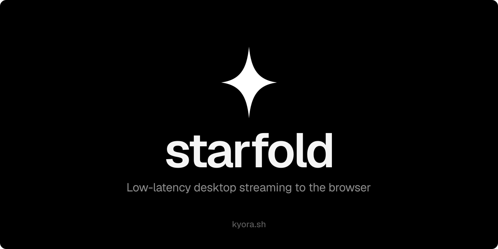
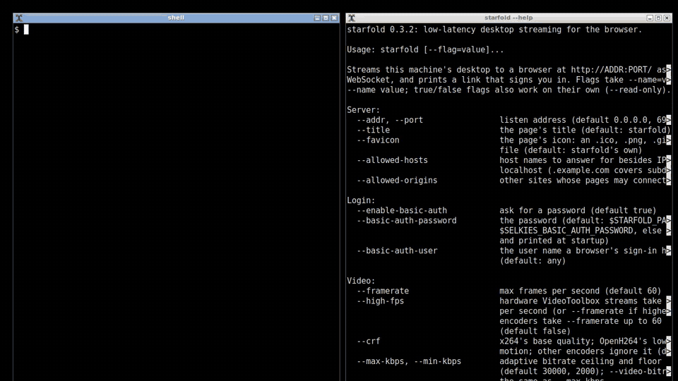

<p align="center">
  <a href="LICENSE"></a>
  <a href="https://github.com/kyora-sh/starfold/actions/workflows/ci.yml"></a>
</p>



kyora starfold streams a desktop to a plain browser tab over one WebSocket: an X11 display (Xvfb
included), a Mac's screen or a Windows desktop. The browser decodes with WebCodecs. H.264 is the
baseline, and the server and the browser negotiate HEVC or AV1 where both have them. It carries the
mouse, keyboard and touch, the clipboard, audio and the microphone, file transfer and dynamic resolution.
Agents get HTTP APIs for screenshots, recordings, input and waiting until the screen settles.

## Quick start

```sh
cargo install --locked --path crates/starfold-server   # needs nasm, libyuv, Opus, PulseAudio and esbuild (see Build)
DISPLAY=:1 starfold         # streams display :1 and prints a link that signs you in
```

Open the link it prints. On a Mac or a Windows PC, `starfold` streams that machine's own screen
instead; see [macOS](#macos) and [Windows](#windows).

## Benchmarks

[`bench/results/2026-11-starfold-vs-novnc.md`](bench/results/2026-11-starfold-vs-novnc.md) measures
starfold against noVNC as kyora runs it, on kyora VMs at 1920x1080 with a 30 fps source, on the LAN
and on 20 and 2 Mbit/s links with 50 ms RTT: frame rate, key-to-paint latency, picture quality against
the X server's own pixels, and bandwidth. The sets of its
[8 November refresh](bench/results/2026-11-starfold-vs-novnc.md#refresh-8-november-2026-13-against-main)
interleave the arms on one VM and carry an A/A arm, so a difference there only counts beyond what the
same binary shows against itself; the file's earlier sets and macOS jobs don't all have those
controls, and each says which it has. The harness is in [`bench/vs/`](bench/vs) and the method,
caveats and raw cells are in the results file.

## Build

Rust, a C++ compiler, nasm, pkg-config, libyuv, libopus, libpulse and esbuild;
`nix-shell --arg withRust true` provides them all (plain `nix-shell` all but Rust, for your own
toolchain). The cargo features pick the software H.264 encoders a build includes: OpenH264,
built from source, and x264 (`--features x264`, needs x264 and clang); see [Licensing](#licensing).

```sh
nix-shell --arg withRust true
cargo build --release
```

Or install it with the same libraries on your system (the crate is `starfold-server`, the binary is
`starfold`):

```sh
cargo install --locked --path crates/starfold-server
```

## Usage

Run it against an X display, then open the link it prints (`?stats` adds an FPS overlay,
`?present=canvas` paints into a canvas instead of `<video>`; a page embedding it can wait for the
`starfold:firstframe` event on `window` rather than `load`):

```sh
DISPLAY=:1 ./target/release/starfold --port=6901
# prints: open http://localhost:6901/?token=4f1c… to sign in
```

Start Xvfb with `-shmem` for zero-copy capture, and use the patched Xvfb
(`nix-build -E 'with import <nixpkgs> {}; callPackage ./xvfb.nix {}'`) for pixel-precise scroll
input; stock Xvfb scrolls by wheel notches. `starfold --help` lists every flag with its default, and
`starfold --version` prints the version.

| Flag                                                           | Default                                                               |                                                                                                                                                                                                           |
| -------------------------------------------------------------- | --------------------------------------------------------------------- | --------------------------------------------------------------------------------------------------------------------------------------------------------------------------------------------------------- |
| `--addr`, `--port`                                             | `0.0.0.0`, `6901`                                                     | listen address                                                                                                                                                                                            |
| `--display`                                                    | `$DISPLAY`                                                            | X display to stream when `DISPLAY` is unset                                                                                                                                                               |
| `--title`                                                      | `starfold`                                                            | the page's title: the browser tab, and the app's name if a viewer installs it                                                                                                                             |
| `--favicon`                                                    | starfold's icon                                                       | the tab's icon: an `.ico`, `.png`, `.gif`, `.webp` or `.svg` file                                                                                                                                         |
| `--enable-basic-auth`                                          | `true`                                                                | ask for a password (see [Login](#login)); `false` serves without one                                                                                                                                      |
| `--basic-auth-password`                                        | `STARFOLD_PASSWORD`, else `SELKIES_BASIC_AUTH_PASSWORD`, else made up | the password                                                                                                                                                                                              |
| `--basic-auth-user`                                            | any                                                                   | the user name a browser's sign-in has to give                                                                                                                                                             |
| `--framerate`                                                  | `60`                                                                  | max frames per second (`60-60` style ranges accepted)                                                                                                                                                     |
| `--high-fps`                                                   | `false`                                                               | hardware VideoToolbox streams take 120 frames per second (or `--framerate` if higher); other encoders take `--framerate` up to 60                                                                         |
| `--encoder`                                                    | `auto`                                                                | `auto`: each codec's hardware encoder that isn't experimental, else OpenH264; or the H.264 one: `openh264`, `videotoolbox`, `x264` (x264 builds), or the experimental `vaapi`, `nvenc`, `mediafoundation` |
| `--encoder-probe`                                              | `true`                                                                | probe the hardware encoders at startup (`/stats` lists what was found)                                                                                                                                    |
| `--experimental-hw-probes`                                     | `false`                                                               | also probe VA-API, NVENC and Media Foundation, each in a child process; needed to name one with `--encoder`, which `auto` never picks                                                                     |
| `--preset`                                                     | `ultrafast`                                                           | x264 preset                                                                                                                                                                                               |
| `--encoder-threads`                                            | `ncpu/4`, from 1 to 4                                                 | sliced encoder threads                                                                                                                                                                                    |
| `--crf`                                                        | `24`                                                                  | x264's base quality; OpenH264's lowest QP in motion; other encoders ignore it                                                                                                                             |
| `--max-kbps` / `--video-bitrate`                               | `30000`                                                               | adaptive bitrate ceiling                                                                                                                                                                                  |
| `--min-kbps`                                                   | `2000`                                                                | adaptive bitrate floor                                                                                                                                                                                    |
| `--paintover-crf`, `--paintover-burst`, `--paintover-delay-ms` | `16`, `3`, `150`                                                      | sharpening when the screen goes still (`--paintover-crf` is x264's; other encoders ignore it)                                                                                                             |
| `--enable-clipboard`                                           | `true`                                                                | `true`, `in`, `out` or `false`                                                                                                                                                                            |
| `--audio-enabled`, `--audio-device-name`, `--audio-bitrate`    | `true`, `output.monitor`, `128000`                                    | desktop audio                                                                                                                                                                                             |
| `--enable-resize`, `--resize-scale`                            | `false`, `1.5`                                                        | desktop follows the viewer's window; desktop pixels per CSS pixel                                                                                                                                         |
| `--microphone-enabled`, `--microphone-fifo`                    | `false`, `/tmp/starfold-mic.fifo`                                     | browser microphone into the FIFO a PulseAudio pipe source reads                                                                                                                                           |
| `--round-corners`                                              | `0` (off)                                                             | corner radius in pixels for top-level windows                                                                                                                                                             |
| `--round-windows`                                              | none                                                                  | `title:radius,...` rounds windows with that title, docks included                                                                                                                                         |
| `--adaptive-threads`                                           | `false`                                                               | encode on one thread, fanning out only under sustained heavy motion                                                                                                                                       |
| `--stripes`                                                    | `1`                                                                   | encode the screen as N independent horizontal streams (experimental)                                                                                                                                      |
| `--scroll-px-per-notch`                                        | `180`                                                                 | desktop pixels one wheel notch scrolls (calibrates smooth scrolling)                                                                                                                                      |
| `--file-transfers`                                             | `upload,download`                                                     | `upload`, `download`, both, or `none`                                                                                                                                                                     |
| `--read-only`                                                  | `false`                                                               | viewers only watch: input, clipboard writes, the microphone, uploads and resizing (`--enable-resize`) are refused                                                                                         |
| `--allowed-hosts`                                              | none                                                                  | host names to answer for besides IP addresses and `localhost` (`.example.com` covers subdomains, `*` any)                                                                                                 |
| `--allowed-origins`                                            | none                                                                  | other sites whose pages may connect, such as a page that embeds starfold's client (`*` any site)                                                                                                          |
| `--files-root`                                                 | (none: no file transfer)                                              | folder the Files panel can see; nothing outside it is reachable and symlinks are not followed                                                                                                             |
| `--upload-dir`                                                 | `Downloads`                                                           | folder, relative to the root, the panel opens and uploads into; created on first upload                                                                                                                   |
| `--max-upload-mb`                                              | `0` (no limit)                                                        | largest accepted upload                                                                                                                                                                                   |
| `--max-record-seconds`                                         | `300`                                                                 | longest recording (`/record`)                                                                                                                                                                             |
| `--convert-threads`, `--coalesce-us`                           | `4`, `0`                                                              | tuning                                                                                                                                                                                                    |

An upload is written to a hidden `.starfold-upload-*` file and renamed when complete, never over
an existing file (a name taken meanwhile gets 409). After a crash, hidden `.starfold-upload-*`
files may remain in the upload folder and can be deleted when no starfold is running. A
filesystem with neither an exclusive rename nor hard links refuses uploads (501). Hiding
those temporary files is best effort: on filesystems with short names (FAT), a signed-in
viewer may be able to see an upload while it is in progress.
A path longer than `PATH_MAX` is refused before anything is created, and an upload needs room
for a 255-byte name under it. On Unix systems other than Linux and macOS, an entry's own name
can't be looked up, so only the name in the request is checked.

### Login

starfold asks for a password before it shows the desktop or takes input, files or API
calls. Give it one with `--basic-auth-password`, `STARFOLD_PASSWORD` or `SELKIES_BASIC_AUTH_PASSWORD`;
otherwise it makes one up when it starts and prints a link that signs you in. There are three ways in:

- **The link**: `http://host:6901/?token=<password>`. The page passes the password on to
  its own connections, so the link also works as an iframe's `src`.
- **The browser's sign-in prompt**, which starfold's page brings up: any user name (unless
  `--basic-auth-user` names one) and the password. Password managers offer to save it.
- **For programs**: `Authorization: Bearer <password>`, or `curl -u :<password>`.

The page's scripts and `/healthz` load without it. If starfold sits behind a proxy that signs
people in itself, `--enable-basic-auth=false` turns starfold's login off.

### Hosts and origins

starfold only answers requests for an IP address or `localhost`, and only from its own page.
That keeps out other web pages, which browsers let connect to any address, including
pages whose domain is pointed at starfold's address (DNS rebinding). To reach starfold under a
host name, such as through a proxy or as `my-pc.local`, name it with `--allowed-hosts`.
To let a page on another site connect, name that site with `--allowed-origins`.
Programs that aren't browsers (curl, scripts, agents) send no `Origin` and connect as
usual. A refused request gets a 403 that names the flag to add.

### For agents and scripts

Screenshots and recordings (start starfold with `STARFOLD_PASSWORD` set, and send it along):

```sh
# the screen as a PNG
curl -u ":$STARFOLD_PASSWORD" -o shot.png localhost:6901/screenshot
# an MP4 of the next 10 s
curl -u ":$STARFOLD_PASSWORD" -o clip.mp4 "localhost:6901/record?seconds=10"
# or start...
id=$(curl -u ":$STARFOLD_PASSWORD" -s -X POST localhost:6901/record/start | jq .id)
# ...and stop when done
curl -u ":$STARFOLD_PASSWORD" -o clip.mp4 -X POST "localhost:6901/record/stop?id=$id"
```

A recording is the H.264 stream starfold sends to viewers, saved as MP4: it shares the
encoding with any viewers taking H.264, and with none it starts an H.264 encoding of its
own. It needs `--stripes=1` (otherwise 409), doesn't include the cursor (viewers draw it),
and a resize ends it.

If another encoder takes over mid-recording (a hardware encoder failing over to OpenH264,
say), the recording continues in a new MP4, up to 16 of them. Add `format=zip` to
`/record` or `/record/stop` for all of them: `segment-1.mp4`, `segment-2.mp4`, ... and a
`manifest.json` with each one's `start_ms`, `duration_ms` and `frames`, and the
`end_reason` (`stopped`, `time_limit`, `resized`, `segment_cap`, `bad_parameter_sets`,
`segment_lost` or `closed`). Without it you get the first MP4, with `x-starfold-segments` and
`x-starfold-record-end` headers when there were more.

`/wait` returns when the screen settles or changes, so an agent doesn't have to sleep
after every action and hope it was long enough:

```sh
# once nothing changed for 300 ms
curl -u ":$STARFOLD_PASSWORD" localhost:6901/wait
# still for 1 s, giving up after 30 s
curl -u ":$STARFOLD_PASSWORD" "localhost:6901/wait?idle=1000&timeout=30000"
# the first change in that rectangle
curl -u ":$STARFOLD_PASSWORD" "localhost:6901/wait?change&region=0,0,800,600"
# {"changed":true,"timed_out":false,"seq":812,"waited_ms":340}
```

`idle` (ms, default 300) is how long the screen has to stay still, counted from the
request at the earliest so an action just taken has time to show; `change` returns at
the first change instead. `region=x,y,w,h` only watches that rectangle (to the 16-pixel
block) and `timeout` (ms, default 10000) gives up. `changed` says whether anything
changed while waiting. A change can land before the request does, so to wait for what an
action caused, pass `since` the `seq` of an earlier `/wait` or the `X-Starfold-Seq` header of
a screenshot: `/wait?change&since=812` returns at once if anything changed after it. A
blinking text caret redraws about twice a second, so keep `idle` under 500 ms or leave
the caret out of `region`. starfold already knows which parts of the screen change (XDamage,
ScreenCaptureKit and DXGI report them), so waiting needs no screenshots or polling.

`POST /input` drives the mouse and keyboard with JSON actions (one, or an array applied in
order) and answers with the `seq` from before them, so `/wait?change&since=` sees what they
did. A `--read-only` server refuses it with 403. `python/starfold` wraps all of this.

```sh
curl -u ":$STARFOLD_PASSWORD" -H 'Content-Type: application/json' localhost:6901/input \
  -d '[{"type":"click","x":400,"y":300},{"type":"type","text":"hello\n"},{"type":"key","key":"ctrl+s"}]'
# {"seq":812,"events":19}
```

### macOS

starfold also streams a Mac's own screen, with every feature of the Linux version
(ScreenCaptureKit capture, CGEvent input, NSPasteboard clipboard, system audio).

```sh
brew install opus pkgconf esbuild
cargo build --release
./target/release/starfold --port=6901
```

Open the link it prints. On a Mac starfold listens on `127.0.0.1` unless `--addr` says
otherwise, since the stream is your whole screen. macOS asks starfold (or the terminal that
starts it) for Screen Recording and Accessibility permissions. For the microphone,
install a loopback device (`brew install blackhole-2ch`) and pick it as the input in the
apps that should hear you.

| macOS flag             | Default                     |                                                                                        |
| ---------------------- | --------------------------- | -------------------------------------------------------------------------------------- |
| `--display`            | main display                | display to stream: an index (0 is the main display) or a display ID; logged at startup |
| `--capture-scale`      | native, within the budget   | streamed pixels per point                                                              |
| `--max-capture-pixels` | `4096000` (2560x1600)       | pixel budget for the automatic scale, which bounds the encoding work on large displays |
| `--microphone-device`  | first loopback device found | output device (name or prefix) to play the browser microphone into                     |
| `--resize-scale`       | the capture scale           | so a viewer's window maps to the same number of points on the Mac                      |

The other flags work as on Linux; `--audio-device-name`, `--microphone-fifo` and the
rounded-corner flags don't apply.

### Windows

starfold also streams a Windows desktop (Windows 10 or later), with every feature of the
Linux version (DXGI Desktop Duplication capture, SendInput, clipboard text and images,
WASAPI system audio). Build it with Rust, [vcpkg](https://vcpkg.io), nasm and esbuild:

```powershell
vcpkg install libyuv opus --triplet x64-windows-static-md
$env:VCPKGRS_TRIPLET = 'x64-windows-static-md'
npm install -g esbuild
cargo build --release
.\target\release\starfold.exe --port=6901
```

Open the link it prints. As on a Mac, starfold listens on `127.0.0.1` unless `--addr` says
otherwise. It streams the desktop of the session it runs in, so start it in the user's
session (not as a service); Windows hides the lock screen and UAC prompts from it unless
it runs as SYSTEM. For the microphone, install a virtual audio cable
([VB-CABLE](https://vb-audio.com/Cable/)): starfold plays into "CABLE Input" and apps record
from "CABLE Output".

| Windows flag          | Default                   |                                                                    |
| --------------------- | ------------------------- | ------------------------------------------------------------------ |
| `--display`           | primary display           | display to stream, by index (0 is the primary); logged at startup  |
| `--audio-device-name` | default output device     | output device (name or prefix) whose sound to stream               |
| `--microphone-device` | first virtual cable found | output device (name or prefix) to play the browser microphone into |
| `--resize-scale`      | the display's scaling     | so a viewer's window maps to the same size on the desktop          |

The other flags work as on Linux; `--microphone-fifo` and the rounded-corner flags don't
apply. Dynamic resolution picks the largest display mode that fits the viewer's window,
and Windows restores the original mode when starfold exits.

## FAQ

**Why a WebSocket and not WebRTC?** One WebSocket goes wherever a web page does: through reverse
proxies, tunnels and sandbox preview URLs, with no TURN servers or UDP ports to
open. The browser decodes each frame the moment it arrives with WebCodecs, without a jitter buffer,
and starfold runs its own rate control, which keeps latency low on a clean link. The trade-off is TCP:
on a link that drops packets a lost packet holds up the frames behind it, where WebRTC can skip ahead.

**Why doesn't the stream load at `http://<ip>:6901`?** Browsers only allow WebCodecs on HTTPS pages
and on localhost. To watch from another machine, put starfold behind a TLS proxy and name its host
with `--allowed-hosts`, or forward the port over SSH and open `localhost`.

**Is it safe to expose?** starfold asks for a password by default but serves plain HTTP, so put it
behind TLS away from localhost. See [SECURITY.md](SECURITY.md).

**Which browsers and devices work?** Any browser with WebCodecs, on an HTTPS page or
localhost:

| Browser                                                                | Works |
| ---------------------------------------------------------------------- | ----- |
| Chrome, Edge and other Chromium browsers 94+, desktop and Android      | Yes   |
| Firefox 130+, desktop                                                  | Yes   |
| Safari 16.4+ and any browser on iPhone or iPad (sound needs Safari 26) | Yes   |
| Firefox for Android                                                    | No    |

Phones and tablets get touch input and an on-screen keyboard.

**Wayland?** Not yet; on Linux starfold streams X11 displays, Xvfb included.

**Does it use the GPU?** On Linux, not by default: H.264 is encoded on the CPU. `--encoder auto` uses
a hardware encoder that isn't experimental where it finds one (VideoToolbox on macOS). The VA-API,
NVENC and Media Foundation encoders are experimental: start with `--experimental-hw-probes` and name
one with `--encoder vaapi`, `nvenc` or `mediafoundation`; `/stats` shows what the probe found.

## Licensing

The source code is MIT ([LICENSE](LICENSE)). The software H.264 encoders are OpenH264
(BSD-2-Clause) and x264 (GPL-2.0-or-later). Which of them a binary includes depends on the cargo
features it was built with; `starfold --version` lists them. A binary that includes x264 is GPL-2.0-or-later as a combined work.
[THIRD_PARTY.md](THIRD_PARTY.md) lists the bundled components and their licences.
